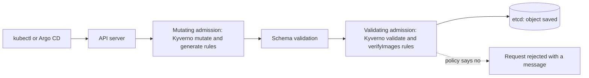

# 1. Concepts: policy as code

## The problem
Anyone with access to a cluster can create a pod that runs as root, uses the `latest` image tag, has no resource limits, or is missing the labels your cost reports need. Reviewing every manifest by hand doesn't scale. A **policy engine** checks every request automatically and either reports or blocks the ones that break your rules.

## Where Kyverno sits
Every change to the cluster goes through the Kubernetes API server. Before an object is saved, the API server calls **admission webhooks**. Kyverno registers webhooks, so it sees every create and update.


Mutation runs before validation, so a mutate rule can fix a resource that a validate rule would otherwise reject.

## Kyverno components
| Component | Job |
|---|---|
| Admission controller | Answers the webhook calls: validate, mutate, verify images |
| Background controller | Runs generate rules and applies mutations to existing resources |
| Reports controller | Scans existing resources and writes policy reports |
| Cleanup controller | Deletes resources on a schedule using cleanup policies |

## Anatomy of a policy
```yaml
apiVersion: kyverno.io/v1
kind: ClusterPolicy             # cluster-wide; use Policy for one namespace
metadata:
  name: my-policy
spec:
  validationFailureAction: Audit    # Audit or Enforce
  background: true                  # also scan existing resources
  rules:
  - name: my-rule
    match: ...                      # which resources the rule applies to
    exclude: ...                    # optional: which ones to skip
    validate | mutate | generate | verifyImages: ...    # exactly one per rule
```

## The four rule types
| Rule | What it does | Example |
|---|---|---|
| `validate` | Allows or blocks a resource | Block the `latest` tag |
| `mutate` | Changes a resource as it is created | Add a default label |
| `generate` | Creates other resources | Default NetworkPolicy for every new namespace |
| `verifyImages` | Checks container image signatures | Only signed images may run |

## Audit and Enforce
- **Audit:** the resource is allowed, and the violation is recorded in a policy report. Start here to see what a policy would break.
- **Enforce:** the API server rejects the request and shows the policy message.

## Other policy resources
| Kind | Purpose |
|---|---|
| `ClusterPolicy` and `Policy` | The rule-based policies used in this lab |
| `PolicyException` | A controlled exception for one workload |
| `ClusterCleanupPolicy` and `CleanupPolicy` | Scheduled deletion |
| `PolicyReport` and `ClusterPolicyReport` | Results of checks, written by Kyverno |

Newer Kyverno releases add a CEL-based policy API as well. See [09-new-policy-types.md](09-new-policy-types.md).

## How it compares
- **ValidatingAdmissionPolicy** is built into Kubernetes and uses CEL, but only validates.
- **OPA Gatekeeper** uses the Rego language.
- **Kyverno** uses Kubernetes-style YAML and can also mutate, generate and verify images.
