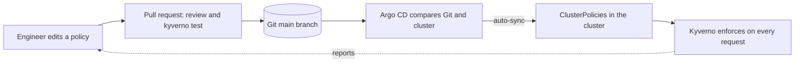

# 8. GitOps for policies: Kyverno and Argo CD together

Policies are code. Keeping them in Git and letting Argo CD apply them gives you review, history, rollback, and automatic drift correction for your cluster guard rails.



## What is in this repo for it
| File | Purpose |
|---|---|
| [argocd/root-app.yaml](../argocd/root-app.yaml) | The root Application. It watches `argocd/applications` |
| [argocd/applications/kyverno.yaml](../argocd/applications/kyverno.yaml) | Installs Kyverno from its Helm chart (sync wave 0) |
| [argocd/applications/policies.yaml](../argocd/applications/policies.yaml) | Applies everything under `policies/` (sync wave 1) |

This is the "app of apps" pattern: one Application creates the others.

## Why these settings
| Setting | Reason |
|---|---|
| `sync-wave` 0 then 1 | Kyverno and its CRDs must exist before any `ClusterPolicy` is applied |
| `ServerSideApply=true` | Kyverno's CRDs are too large for Argo CD's default client-side apply |
| `SkipDryRunOnMissingResource=true` | The first dry run happens before the ClusterPolicy CRD exists |
| `CreateNamespace=true` | Creates the `kyverno` namespace |
| `selfHeal` and `prune` | Manual changes are reverted, and deleted files are removed from the cluster |

## Lab
You need a cluster with Argo CD installed (see [07](07-argocd-basics.md)) and this repo pushed to a GitHub repository that Argo CD can read.

**1. Push this repo to GitHub.** The manifests in `argocd/root-app.yaml` and `argocd/applications/policies.yaml` point at `https://github.com/Kasthuri-12/kyverno-argocd-learning-lab.git`. If you use another account or repo name, change that URL in both files. Commit and push to `main`. For a private repo, add the repo credentials in the Argo CD settings first.

**2. Start everything with one command:**
```bash
kubectl apply -f argocd/root-app.yaml
kubectl get applications -n argocd -w
```
The `root` app creates `kyverno`, then `policies`. Wait until all three are `Synced` and `Healthy`.

**3. Check the result:**
```bash
kubectl get pods -n kyverno
kubectl get clusterpolicy
```

**4. Change a policy through Git.** In `policies/validate/disallow-latest-tag.yaml`, change `validationFailureAction: Audit` to `Enforce`, commit and push. Argo CD picks it up (poll interval is a few minutes, or click **Refresh**), then:
```bash
kubectl run latest-test --image=nginx:latest        # now rejected
```

**5. Try to bypass Git.** Change the policy back by hand:
```bash
kubectl patch clusterpolicy disallow-latest-tag --type merge -p '{"spec":{"validationFailureAction":"Audit"}}'
```
Argo CD shows `OutOfSync` and, with self-heal, puts `Enforce` back. That is drift correction.

**6. Roll back.** `git revert` the commit and push. The cluster follows.

## If an app stays OutOfSync
Open the diff in the Argo CD UI. Kyverno adds default fields to policies when it admits them, and Argo CD can see that as a difference. If so, add an `ignoreDifferences` entry for those fields on the `policies` Application.

## Clean up
```bash
kubectl delete application root -n argocd
kubectl delete application policies kyverno -n argocd --ignore-not-found
helm list -A                                       # remove anything Argo CD left behind
```
Because of `prune`, deleting the Applications removes what they created. Check `kubectl get pods -n kyverno` afterwards.
